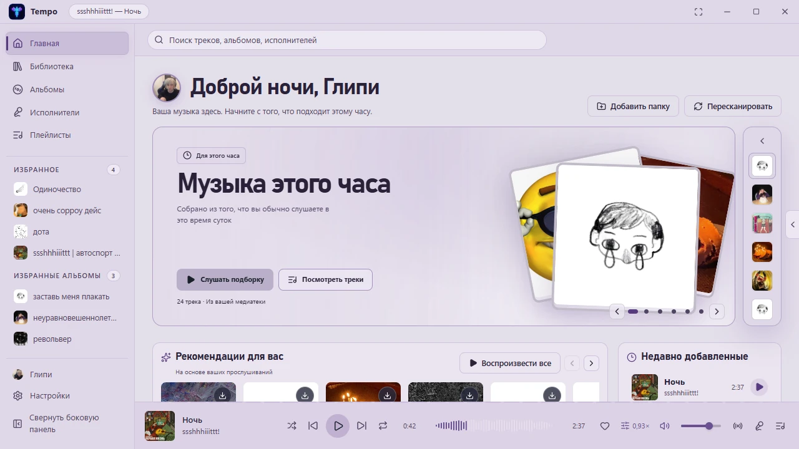
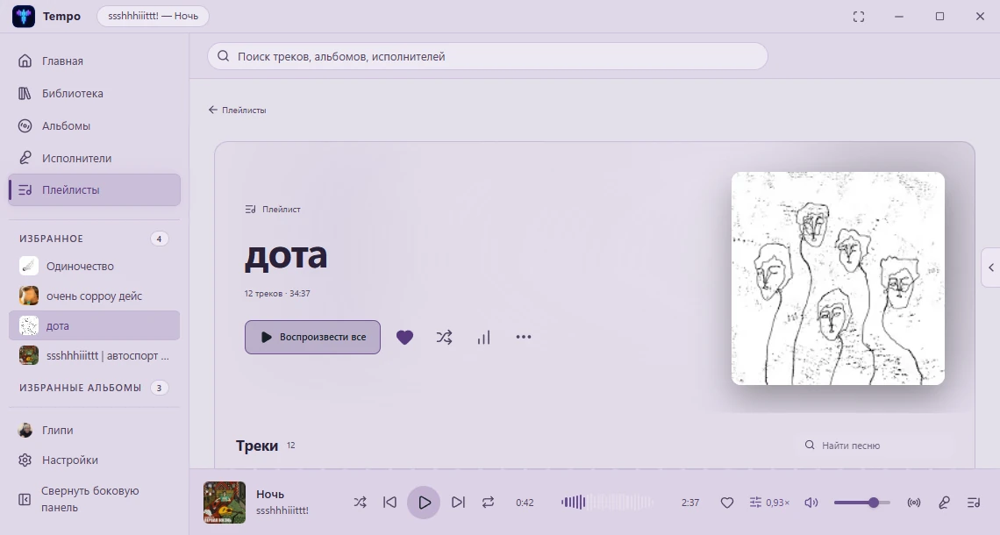
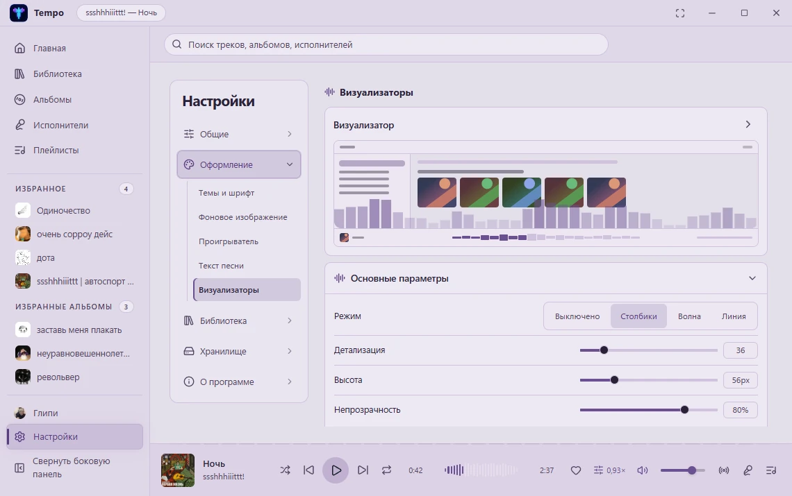
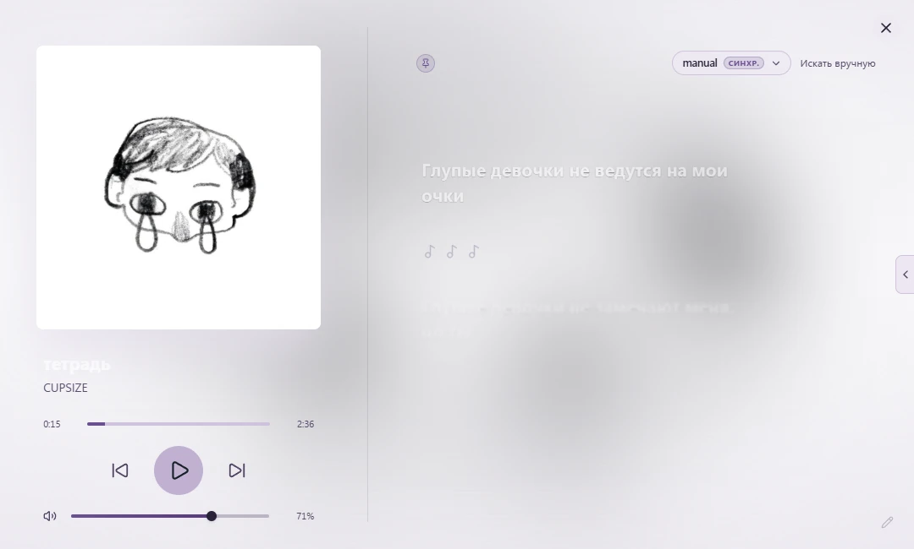
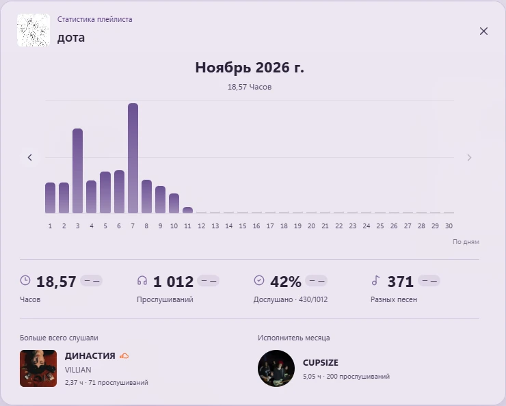

# Tempo

Tempo is a Windows music player for the songs you keep on your PC and the music you find on SoundCloud and YouTube Music. Bring them into the same queue, make playlists, and see what you’ve been listening to.

[Русская версия](README.ru.md) · [What’s new in 1.6.0](docs/releases/v1.6.0.md) · [The update in pictures](docs/design/changelog-1.6.0/tempo-1.6.0-changelog.webp)

## Install and play your first song

1. [Download Tempo 1.6.0 for Windows x64](https://github.com/GLIPIYT/tempo-player/releases/download/v1.6.0/Tempo_1.6.0_x64-setup.exe) and run the installer.
2. On **Home**, click **Add folder** and choose where you keep your music. Tempo reads the tags and artwork and leaves the original files where they are. It supports MP3, FLAC, M4A, AAC, OGG, Opus and WAV.
3. To find music online, open **Search** and choose the **SoundCloud** or **YouTube Music** tab. Right-click a result to queue it or add it to a playlist.

Already using Tempo? Open **Settings → About → Updates** to check for a new version.

## Pick something to listen to

Open **Home** when you don’t know what to put on. Play the featured mix or open its track list first. Hover over the column of covers on the right to switch mixes or choose **Your rule** and build one around the artists, genres and sources you want. Below it are recommendations, likes, recent listening and the playlists you play most.



When you know what you want, your library lets you browse by track, artist, album or playlist. The **Artists** page puts the artists you listen to most at the top. You can start a playlist with local and online tracks, import an existing M3U or M3U8 list from **Playlists**, or export a playlist to M3U8 from its menu.



## Make it sound and look the way you want

If one song is much louder than the rest or you prefer it a little slower, right-click it and open **Track settings**. Enable personal volume, personal speed or both. Tempo remembers those values for that song. For changes across your queue, use loudness normalization, crossfade or the ten-band equalizer. The equalizer works with local and cached audio.

In **Settings → Appearance**, pick a light or dark theme, set up your own colors and backgrounds, or change the font and interface scale. Custom themes can use a Light or Dark appearance, or choose it automatically from your colors. The sidebar jumps to the control you need on the same page. The previews let you see how the lyrics and visualizer will look. You can also switch to a floating mini-player or share what’s playing through Discord Rich Presence.



Want to see where the chorus starts? Enable **Waveform progress bar** under **Appearance → Player**. Tempo can draw it from local audio and from YouTube Music audio it prepares for playback.

## Follow the lyrics

Click the microphone icon in the player bar to open the lyrics screen. When synced lyrics are available, you can follow them line by line or word by word. If the words and timings come from different versions, the editor lets you combine them or correct the text yourself. In **Appearance → Lyrics**, you can keep the text white with a dark outline in light themes. The **Visualizers** section has separate controls for the lyrics visualizer.



## See what you’ve been listening to

Click your name in the sidebar to open your profile and listening history. Click a bar to see a day or month in detail, then open an hour for a breakdown in five-minute intervals. Select a featured song or artist in a report to open its own history.

For a local playlist, album or artist, use the chart icon on its page. Playlist reports credit new plays to the playlist you started them from. History recorded before 1.6.0 is estimated from the previous plays of tracks that are currently in the playlist.



## Offline listening and connection problems

Your library, playlists and listening history are stored on your PC. Local files and supported tracks you’ve cached can play offline. Public SoundCloud tracks are available without signing in. Account-only tracks require a SoundCloud sign-in. Online search, streaming, online lyrics, recommendations and update checks use the internet. Streams and some formats, including Opus, may need an automatic FFmpeg download the first time.

If a service stops loading, open **Settings → About → Connectivity** and select **Check connections** to see which services respond. You can copy the report and attach it when [opening an issue](https://github.com/GLIPIYT/tempo-player/issues).

<details>
<summary>Keyboard shortcuts</summary>

Use these while the Tempo window is active and focus is outside a text field or control.

| Key | Action |
| --- | --- |
| `Space` | Play or pause |
| `←` / `→` | Previous or next track |
| `Ctrl` + `←` / `→` | Seek one second backward or forward |
| `↑` / `↓` | Raise or lower volume by 5% |
| `M` | Mute or unmute |
| `S` | Toggle shuffle |
| `R` | Cycle repeat modes |

</details>

## Run Tempo from source

Install Node.js 22, stable Rust and the [Tauri prerequisites for Windows](https://tauri.app/start/prerequisites/#windows). Then clone the repository and launch the desktop app.

```bash
git clone https://github.com/GLIPIYT/tempo-player.git
cd tempo-player
npm ci
npm run tauri dev
```

Use `npm run tauri build` to build a Windows installer. Use `npm run dev` for frontend-only work. Library scanning, audio playback and system integrations require the desktop app.

```bash
npm run check
cargo test --locked --manifest-path src-tauri/Cargo.toml
```

Tempo uses Tauri, React and TypeScript for the desktop interface, with a Rust core for playback and SQLite for the library. See the [architecture guide](ARCHITECTURE.md) for how the app fits together.

[Releases](https://github.com/GLIPIYT/tempo-player/releases) · [Issues](https://github.com/GLIPIYT/tempo-player/issues) · [MIT license](LICENSE)

[](https://github.com/GLIPIYT/tempo-player/actions/workflows/ci.yml)
