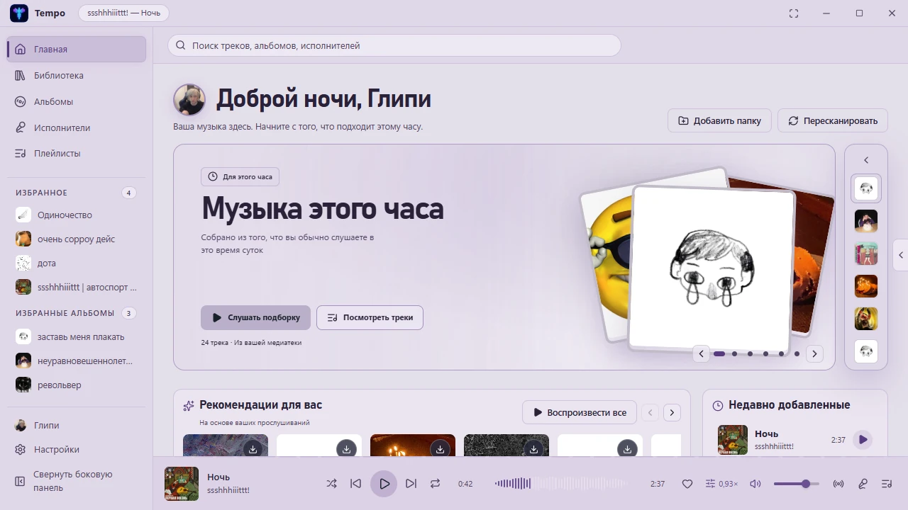
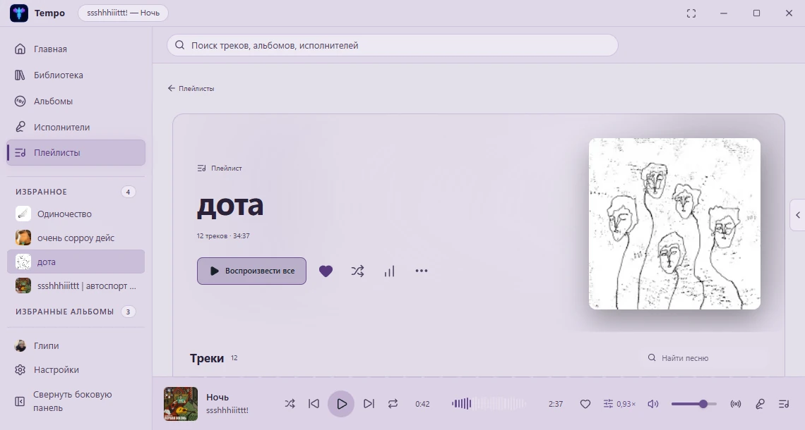
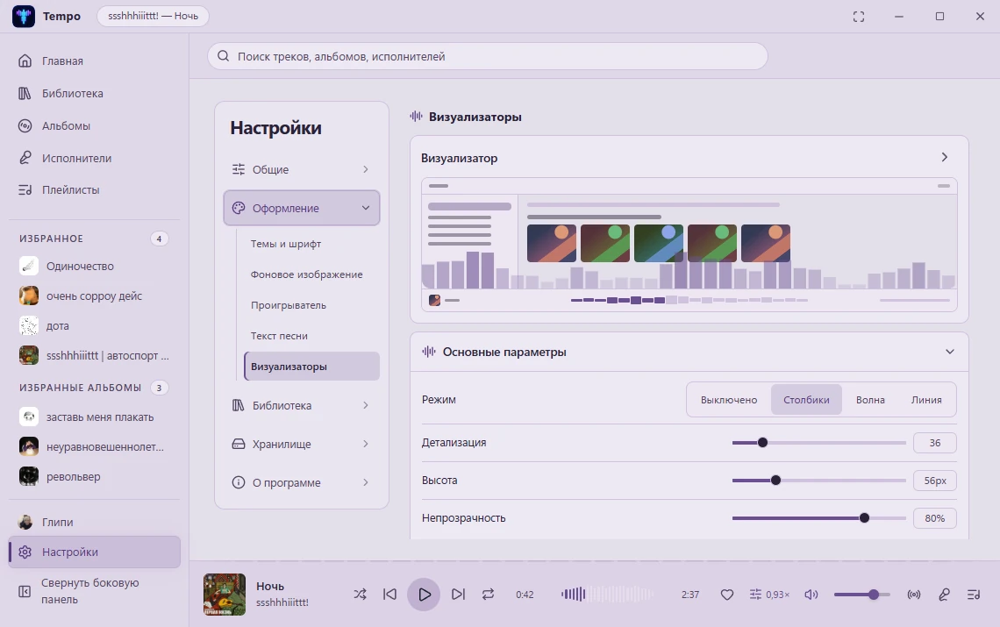
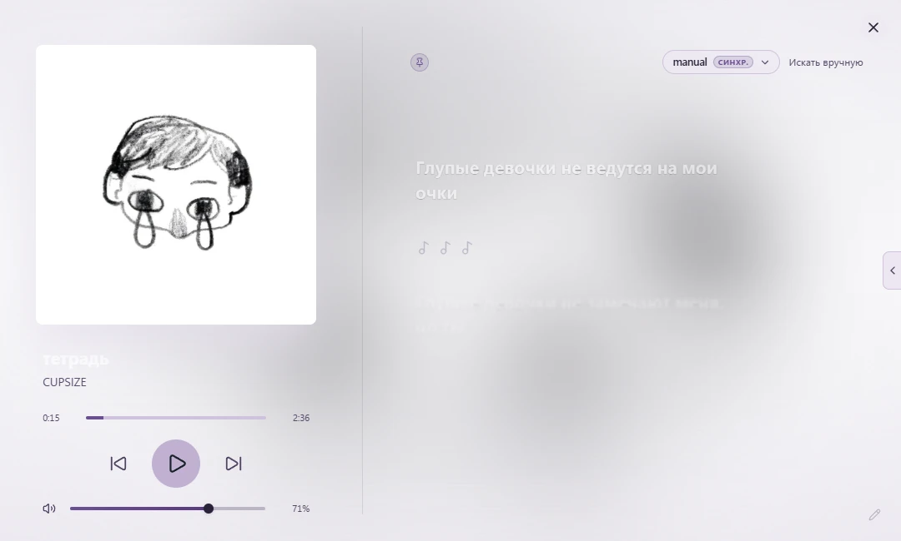
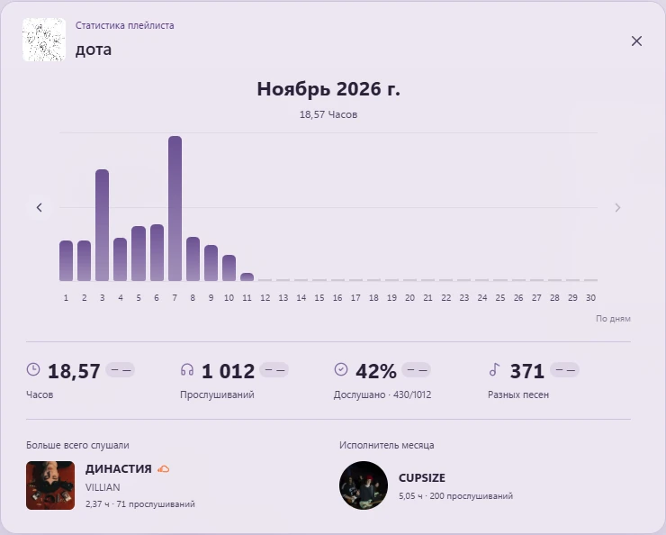

# Tempo

Tempo — музыкальный плеер для Windows. В нём можно слушать файлы с компьютера и находить музыку на SoundCloud и YouTube Music. Добавляй всё в одну очередь, собирай плейлисты и смотри, какие песни слушаешь чаще всего.

[English version](README.md) · [Что нового в 1.6.0](docs/releases/v1.6.0.md#русский) · [Обновление в картинках](docs/design/changelog-1.6.0/tempo-1.6.0-changelog.webp)

## Установи Tempo и включи первую песню

1. [Скачай Tempo 1.6.0 для Windows x64](https://github.com/GLIPIYT/tempo-player/releases/download/v1.6.0/Tempo_1.6.0_x64-setup.exe) и запусти установщик.
2. На **Главной** нажми **«Добавить папку»** и выбери, где хранится музыка. Tempo прочитает названия, исполнителей и обложки. Сами файлы останутся на своих местах. Поддерживаются MP3, FLAC, M4A, AAC, OGG, Opus и WAV.
3. Чтобы найти что-нибудь в сети, открой **«Поиск»** и выбери вкладку **SoundCloud** или **YouTube Music**. Нажми по треку правой кнопкой, чтобы поставить его в очередь или добавить в плейлист.

Если Tempo уже установлен, новую версию можно проверить в **«Настройки → О программе → Обновления»**.

## Найди, что включить

Загляни на **Главную**, если хочется музыки, но пока непонятно какой. Большую подборку можно сразу включить или сначала открыть список треков. Наведи курсор на колонку с обложками справа, чтобы выбрать другую подборку. А через **«Своё правило»** можно собрать свою, например по любимым исполнителям, жанрам и источникам. Ниже есть рекомендации, лайки, недавние прослушивания и плейлисты, которые ты часто включаешь.



Если уже знаешь, что хочешь послушать, в медиатеке можно открыть треки, исполнителей, альбомы и плейлисты. На странице **«Исполнители»** первыми идут те, кого ты слушаешь чаще всего. В один плейлист можно добавить файлы с компьютера и треки из сети. В разделе **«Плейлисты»** можно импортировать готовый список M3U или M3U8, а через меню самого плейлиста — экспортировать его в M3U8.



## Настрой звук и оформление под себя

Если одна песня заметно громче остальных или тебе нравится слушать её чуть медленнее, нажми по ней правой кнопкой и открой **«Настройки трека»**. Включи персональную громкость, скорость или обе настройки. Tempo запомнит их для этой песни. Для всей очереди есть нормализация громкости, плавные переходы между треками и десятиполосный эквалайзер. Эквалайзер работает с локальной и кэшированной музыкой.

В **«Настройки → Оформление»** можно выбрать светлую или тёмную тему, настроить свои цвета и фон, поменять шрифт и масштаб интерфейса. Для своей темы можно выбрать светлый или тёмный вид либо определять его автоматически по выбранным цветам. Боковой список прокручивает страницу к нужному блоку, а в превью видно, как будут выглядеть лирика и визуализатор. Можно также открыть плавающий мини-плеер или показывать текущий трек в Discord через Rich Presence.



Хочешь видеть, где начинается припев? Включи **«Волновой индикатор прогресса»** в разделе **«Оформление → Проигрыватель»**. Tempo строит его по локальным файлам и по аудио YouTube Music, подготовленному для воспроизведения.

## Следи за текстом песни

Нажми кнопку с микрофоном на панели плеера. Если есть синхронизированная лирика, Tempo подсвечивает её по строкам или по словам. В редакторе можно поправить текст или взять тайминги из другой версии. В разделе **«Оформление → Текст песни»** можно оставить белый текст с тёмной обводкой даже в светлой теме. Для визуализатора на экране лирики есть отдельные параметры в разделе **«Визуализаторы»**.



## Посмотри, что ты слушал

Нажми на своё имя в боковой панели, чтобы открыть профиль и историю прослушиваний. Нажми на столбик, чтобы открыть подробности месяца или дня. В отчёте дня можно выбрать час и посмотреть активность с шагом в пять минут. Нажатие на песню или исполнителя в отчёте открывает их собственную статистику.

На странице локального плейлиста, альбома или исполнителя отчёт открывается кнопкой с графиком. Новые прослушивания учитываются в том плейлисте, из которого ты запустил музыку. История до версии 1.6.0 оценивается по прошлым прослушиваниям песен, которые сейчас входят в плейлист.



## Прослушивание офлайн и проблемы с подключением

Медиатека, плейлисты и история хранятся на компьютере. Локальные файлы и сохранённые в кэше треки можно слушать офлайн. Публичные треки SoundCloud доступны без аккаунта, а для треков с ограниченным доступом потребуется вход. Для поиска в сети, стриминга, загрузки лирики, рекомендаций и проверки обновлений нужен интернет. При первом воспроизведении потокового аудио или некоторых форматов, включая Opus, Tempo может автоматически скачать FFmpeg.

Если какой-то сервис перестал загружаться, открой **«Настройки → О программе → Диагностика сети»** и нажми **«Проверить подключение»**. Плеер покажет, какие сервисы отвечают. Отчёт можно скопировать и приложить к [сообщению о проблеме](https://github.com/GLIPIYT/tempo-player/issues).

<details>
<summary>Горячие клавиши</summary>

Клавиши работают, когда окно Tempo активно, а фокус находится вне поля ввода или элемента управления.

| Клавиша | Действие |
| --- | --- |
| `Пробел` | Воспроизвести или поставить на паузу |
| `←` / `→` | Предыдущий или следующий трек |
| `Ctrl` + `←` / `→` | Перемотать на секунду назад или вперёд |
| `↑` / `↓` | Увеличить или уменьшить громкость на 5% |
| `M` | Выключить или вернуть звук |
| `S` | Переключить перемешивание |
| `R` | Переключить режим повтора |

</details>

## Запусти Tempo из исходников

Установи Node.js 22, стабильный Rust и [зависимости Tauri для Windows](https://tauri.app/start/prerequisites/#windows). Затем склонируй репозиторий и запусти приложение.

```bash
git clone https://github.com/GLIPIYT/tempo-player.git
cd tempo-player
npm ci
npm run tauri dev
```

Команда `npm run tauri build` собирает установщик Windows. Для работы только над интерфейсом можно запустить `npm run dev`. Сканирование медиатеки, воспроизведение звука и системные функции доступны в настольном приложении.

```bash
npm run check
cargo test --locked --manifest-path src-tauri/Cargo.toml
```

Интерфейс Tempo написан на React и TypeScript и работает в Tauri. За воспроизведение отвечает Rust, а данные медиатеки лежат в SQLite. О том, как это устроено, написано в [документе об архитектуре](ARCHITECTURE.md).

[Релизы](https://github.com/GLIPIYT/tempo-player/releases) · [Сообщить о проблеме](https://github.com/GLIPIYT/tempo-player/issues) · [Лицензия MIT](LICENSE)

[](https://github.com/GLIPIYT/tempo-player/actions/workflows/ci.yml)
