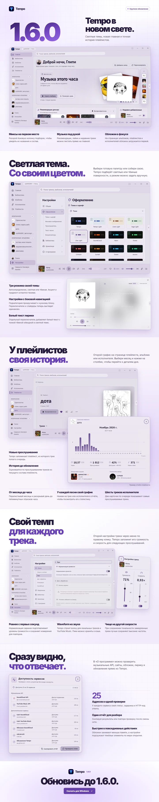

<!-- tempo:release-type=major -->

# Tempo v1.6.0

## English

### Release overview

Tempo 1.6.0 is a major update with light themes, a new Home layout and a redesigned Settings sidebar. You can now give each track its own volume and speed, open a listening report for a specific playlist, and check whether Tempo can reach its music services from your device.

### A lighter look and easier browsing

- **Light palettes with their own character.** Choose a ready-made light theme or set a custom theme to Automatic, Light or Dark. Tempo adapts text, buttons and translucent surfaces to the selected palette. Lyrics can use white text with a thin dark outline in light themes.
- **Settings that are easier to navigate.** The sidebar lists categories and their sections. Select a section to scroll to it. Settings groups open and close smoothly, switches and sliders share a consistent design, and previews show the visualizer and lyrics controls. Theme swatches are compact.
- **Mixes lead the new Home.** The collapsible mix column keeps the cover stacks in view. Expand it for names and actions. Recommendations and genre picks sit next to recently added tracks and frequently played playlists, with separate shelves for likes and recent listening. Use the track menu directly on recommendations.
- **A new Artists catalog.** Frequently played artists appear first with portrait artwork. More artists load as you scroll. Album, artist and playlist pages now use consistent actions and cover treatments, including SoundCloud and YouTube Music collections where supported. Main artwork loads first on collection details, and the profile header fades into its background more softly.

### Sound the way you like it

- **Volume and speed for each track.** Open Track Settings from the track’s context menu. Each control can be enabled separately, and its value is saved for the next play.
- **More consistent loudness.** Tempo analyzes decoded audio, saves file measurements for later plays and prepares the initial gain before playback. The SoundCloud stream keeps its volume correction more consistently. When pitch preservation is enabled, slower playback better retains high frequencies.
- **Waveforms from the audio itself.** Turn on Waveform progress bar to see the shape of local tracks and prepared YouTube Music tracks. Enable Cache waveform data to keep peaks for up to 12 hours, including across restarts.

### Listening reports for individual tracks and collections

- **Open the graph from a local album, artist or playlist.** The report shows artwork and activity for the selected item. Select a track or artist inside a report to open its history. Browse months with the arrows and drill down to days and five-minute intervals. Artist reports cycle through up to six tracks in two slots.
- **Playlists have their own listening history.** New plays are credited to the playlist that supplied the queue entry. Older plays are estimated from the playlist’s current tracks. A new play from the library is included in overall history.

### Diagnostics and everyday fixes

- **Check connections from About.** The diagnostics window checks 25 public addresses across music APIs, websites, artwork, lyrics and updates. It shows response status, latency and HTTP codes when available. Copy a report or run the check again.
- **Less work while browsing.** Home displays its first sections sooner, uses appropriately sized cover thumbnails and renders recommendation cards near the visible part of the shelf. Settings defer expensive work until needed. Playback startup also frees unused mini-player resources and does less work at the moment you start a track.
- **More reliable recommendations and artwork.** Concurrent recommendation writes can wait for the current write to finish. Home recommendation menus open at the pointer. YouTube Music prefers higher-quality artwork and retains a usable fallback across the library, artwork viewer and lyrics.
- **Packaging and documentation.** Third-party license notices are supplied alongside the source and in the installer. This release includes a visual changelog rendered with Tempo’s UI components.

### Download

- **Windows x64 (NSIS)** · [Release page](https://github.com/GLIPIYT/tempo-player/releases/tag/v1.6.0)

## Русский

### О релизе

Tempo 1.6.0 — крупное обновление со светлыми темами, новой главной и боковой навигацией в настройках. У каждого трека могут быть свои громкость и скорость. Теперь можно открыть отдельный отчёт по плейлисту и проверить доступность музыкальных сервисов прямо из плеера.

### Светлое оформление и удобная навигация

- **Светлые палитры со своим характером.** Выбирай готовую тему или задай для своей темы режим «Автоопределение», «Светлая» или «Тёмная». Tempo подбирает цвета текста, кнопок и полупрозрачных поверхностей под выбранную палитру. Для лирики в светлой теме можно включить белый текст с тонкой тёмной обводкой.
- **Проще найти нужную настройку.** Слева появились категории и их разделы. Нажми на раздел, чтобы прокрутить к нему. Блоки плавно раскрываются, переключатели и слайдеры оформлены одинаково, а у визуализатора и лирики есть превью. Образцы тем стали компактнее.
- **Подборки на первом месте.** В свёрнутой колонке видны обложки подборок. Раскрой её, чтобы увидеть названия и действия. Рядом с рекомендациями и жанровыми полками находятся недавно добавленные треки и часто включаемые плейлисты. Для лайков и недавних прослушиваний есть отдельные ряды. У треков из рекомендаций работает контекстное меню.
- **Новый каталог исполнителей.** Часто прослушиваемые исполнители идут первыми и выделяются портретами. Остальные подгружаются при прокрутке. Альбомы, исполнители и плейлисты получили общие действия и оформление обложек, в том числе в поддерживаемых коллекциях SoundCloud и YouTube Music. На страницах коллекций главная обложка загружается первой, а подсветка шапки профиля плавнее переходит в фон.

### Звук под твои привычки

- **Громкость и скорость для каждого трека.** Открой «Настройки трека» через меню по правому клику. Каждый регулятор включается отдельно, а значение сохраняется для следующего прослушивания.
- **Стабильнее громкость.** Tempo анализирует аудио, сохраняет измерения файла для повторов и подготавливает начальную поправку заранее. Поток SoundCloud стабильнее держит её во время воспроизведения. При сохранении тональности замедление лучше сохраняет высокие частоты.
- **Waveform по реальному звуку.** Включи волновой индикатор, чтобы видеть форму локальных треков и подготовленных треков YouTube Music. Настройка кэширования хранит пики до 12 часов, в том числе между запусками.

### Отчёты по трекам и коллекциям

- **График на странице локального альбома, исполнителя и плейлиста.** В отчёте видны обложка и активность выбранного объекта. Нажми на песню или исполнителя внутри отчёта, чтобы открыть его историю. Месяцы перелистываются стрелками, а день можно раскрыть до пятиминутных отрезков часа. У исполнителя две карточки по очереди показывают до шести популярных треков.
- **У плейлистов своя история.** Новые прослушивания считаются для плейлиста, из которого трек попал в очередь. Старые оцениваются по текущему составу. Новый запуск из медиатеки идёт в общую историю.

### Диагностика и повседневные улучшения

- **Проверка подключения в «О программе».** Диагностика проверяет 25 публичных адресов музыкальных API, сайтов, обложек, лирики и обновлений. Она показывает статус ответа, задержку и HTTP-код, когда сервер его вернул. Результаты можно скопировать или запустить проверку заново.
- **Меньше работы при навигации.** Главная раньше показывает первые секции, использует миниатюры подходящего размера и рисует карточки рекомендаций рядом с видимой частью полки. Настройки откладывают тяжёлые операции до открытия нужного блока. При запуске трека освобождаются ресурсы неиспользуемого мини-плеера и выполняется меньше фоновой работы.
- **Надёжнее рекомендации и обложки.** Сохранение рекомендаций ждёт завершения параллельной записи. Меню треков на главной открывается у курсора. Для YouTube Music Tempo предпочитает качественные обложки и сохраняет рабочий вариант для библиотеки, просмотра обложки и лирики.
- **Документация и сборка.** Уведомления о сторонних лицензиях приложены к исходникам и установщику. В релиз включён визуальный ченджлог, собранный из компонентов Tempo.

### Скачать

- **Windows x64 (NSIS)** · [Страница релиза](https://github.com/GLIPIYT/tempo-player/releases/tag/v1.6.0)
