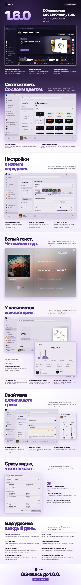

<!-- tempo:release-type=major -->

# Tempo v1.6.0

## English

### Release overview

Tempo 1.6.0 is a major update. Home puts your mixes up front, Settings makes it easier to find a control, and light themes reach across the player. You can also give a particular song its own volume and speed, see how often you played a playlist, and check individual connections when a music service is having trouble.

### New features

#### Light themes and lyrics

- **Four new light themes.** Open **Settings → Appearance → Themes and fonts** and try Tempo Light, Linen Light, Sage Light or Lilac Light. The accents carry through to buttons, the sidebar and the player. Background images still show through translucent surfaces.
- **Choose how a custom theme behaves.** Set it to Automatic, Light or Dark. Automatic uses the brightness of the colors you chose. Light and Dark let you keep your preferred appearance while changing colors or gradients. The mini-player follows the saved theme.
- **Keep white lyrics in a light theme.** Under **Settings → Appearance → Lyrics**, turn on **White text in light theme**. The words get a thin dark outline for contrast. The lyrics backdrop and visualizer also adapt to the light palette.

#### Volume, speed and waveforms

- **Give a track its own settings.** Right-click a track and open **Track settings**. Turn on personal volume, personal speed, or both. The two values are saved for that track. For example, you can replay a song at a slower speed while other songs keep your usual speed.
- **Adjust each control separately.** Personal volume goes from 0 to 100%, and personal speed goes from 0.5× to 2×. Turning a personal control off returns that track to your usual setting. The menu is also available on supported tracks from online results and recommendations.
- **See the shape of the sound while seeking.** Enable **Waveform progress bar** under **Settings → Appearance → Player**. Tempo draws peaks from local audio and from the YouTube Music audio prepared for playback. The optional **Cache waveform data** setting keeps peaks on the device for up to 12 hours, including between launches.

#### Listening statistics for a track or collection

- **Open a report from a local collection.** On an album, artist or playlist page, select the chart icon. The report shows its cover, listening time, track plays, how many of those plays reached completion, and how many different tracks you heard. Use the arrows to move between months.
- **Go from the month to a particular time.** Select a day on the monthly chart, then an hour to see five-minute intervals. The report shows the previous period with listening activity for comparison when one is available. Select a featured song or artist to open its own report. An artist report cycles through up to six songs in two cards.
- **New listening is credited to the playlist you used.** If the same song is in “Road trip” and “Evening”, playing it from “Road trip” counts toward that playlist. Playing it directly from your library still counts in your overall history. New plays stay with their original playlist even if you later remove the track from it.
- **Older playlist figures are estimates.** For listens recorded before this update, Tempo looks at the songs currently in the playlist and counts their past plays. You can see these estimates alongside the new playlist-specific records.

#### Check a connection from Tempo

- **See which services respond.** Go to **Settings → About → Connectivity** and select **Check connections**. The centered window checks 25 public addresses, including the SoundCloud and YouTube Music APIs, their websites, and services for artwork, lyrics and updates.
- **Read or share the result.** Each row shows whether the service responded, how long it took and the response code when available. The check uses public endpoints without an account sign-in. Use **Copy report** to share the results or **Check again** after changing networks.

### Improvements

#### Settings that are easier to browse

- **Jump to the setting you need.** General, Appearance, Library, Storage and About have a shared sidebar. Select a subsection to scroll to it on the same page, with a brief highlight to show where you landed.
- **Open up the controls you want.** Groups expand and collapse smoothly, including the list of subsections in the sidebar. Switches and sliders have a consistent look, and the theme samples are compact enough to scan together.
- **See changes before leaving Settings.** The lyrics preview shows text and highlighting. The visualizer preview lets you switch between the player and lyrics views to see which one you are adjusting. Settings load heavier previews and supporting controls as you reach them, so opening Appearance does less work up front.

#### Home and music browsing

- **Your mixes have their own place on Home.** The large featured mix shows a stack of covers and gives you a choice between playing it and opening its track list. Hover over or expand the narrow mix column to see titles, switch mixes or open your own rule.
- **Find the right list faster.** Personal and genre recommendations sit alongside recently added tracks and frequently played playlists. Likes and recent listening have their own rows. The separate “Long time no listen” row was removed. Section icons, consistently sized covers and less prominent scrollbars make the rows easier to scan and browse.
- **Frequently played artists come first.** The Artists page gives them larger portrait cards. The rest of the catalog loads as you scroll.
- **Familiar controls on collection pages.** Local albums, playlists and artists share the updated presentation with supported SoundCloud and YouTube Music collections. Play, shuffle and favorite controls follow the same layout where available. The main artwork gets priority, and the profile header’s glow fades more softly into the page.

### Fixes and reliability

- **Fewer volume surprises.** When normalization is on, Tempo prepares the first volume adjustment before the track starts and saves measurements for repeat plays. SoundCloud streaming also keeps its initial correction more consistently as playback continues.
- **Clearer sound when slowing down.** With pitch preservation enabled, slower playback keeps more of the high frequencies that could previously sound muffled.
- **Less waiting around playback and Home.** The app does less background work at the moment you start a song and frees resources from an unused mini-player. Home can show its first sections sooner and uses smaller thumbnails and fewer offscreen cards for the recommendation rows. Genre recommendations make fewer requests on the initial load.
- **Recommendation saves handle busy moments better.** Tempo waits for an overlapping write to finish so that saving recommendations is less likely to fail with a “database is locked” message.
- **Track menus open where you click.** Right-click works on both personal and genre recommendations on Home. The SoundCloud search results also give you access to track settings from the row menu.
- **Sharper, more dependable YouTube Music artwork.** Tempo looks for a larger image when a screen needs one and tries another available image if the preferred one fails. This helps in the library, the large artwork view and the lyrics screen.

### Documentation and packaging

- The [visual changelog](https://raw.githubusercontent.com/GLIPIYT/tempo-player/main/docs/design/changelog-1.6.0/tempo-1.6.0-changelog.webp) uses rendered Tempo screens. The README highlights the new layout and links to the illustrated changes and full notes.
- Third-party notices, including those for the loudness processing libraries, are provided with the source and installer. The release publishes the installer and its notes together.

### Download

- **Windows x64 (NSIS)** · [Download installer](https://github.com/GLIPIYT/tempo-player/releases/download/v1.6.0/Tempo_1.6.0_x64-setup.exe)

## Русский

### О релизе

Tempo 1.6.0 — крупное обновление. На новой главной подборки сразу на виду, в настройках легче найти нужный переключатель, а светлые темы применяются ко всему плееру. Для отдельной песни теперь можно задать свои громкость и скорость. Ещё появились подробные отчёты по плейлистам и окно, в котором видно, какие музыкальные сервисы отвечают.

### Новые возможности

#### Светлые темы и лирика

- **Четыре новые светлые темы.** Открой **Настройки → Оформление → Темы и шрифт** и попробуй Tempo Light, Linen Light, Sage Light или Lilac Light. Цвета выбранной темы видны на кнопках, боковой панели и в плеере. Обои по-прежнему просвечивают через полупрозрачные элементы.
- **Выбери режим для своей темы.** Доступны автоопределение, светлый и тёмный режимы. При автоопределении Tempo смотрит на яркость выбранных цветов. Светлый или тёмный режим можно закрепить вручную и дальше менять цвета и градиенты. Мини-плеер подхватывает сохранённую тему.
- **Оставь лирику белой в светлой теме.** В разделе **Настройки → Оформление → Текст песни** включи **«Белый текст в белой теме»**. У слов появится тонкая тёмная обводка для контраста. Фон экрана лирики и визуализатор тоже подстраиваются под светлую палитру.

#### Громкость, скорость и форма волны

- **У каждого трека могут быть свои настройки.** Нажми правой кнопкой на трек и открой **«Настройки трека»**. Включи персональную громкость, скорость или оба регулятора. Tempo запомнит эти значения. Например, одну песню можно всегда слушать медленнее, а остальные продолжат играть с привычной скоростью.
- **Регуляторы включаются отдельно.** Персональная громкость задаётся от 0 до 100%, скорость — от 0,5× до 2×. Когда выключаешь один из регуляторов, трек снова использует общую настройку плеера. Меню также работает у поддерживаемых треков из поиска и рекомендаций.
- **При перемотке видно форму звука.** Включи **«Волновой индикатор прогресса»** в разделе **Настройки → Оформление → Проигрыватель**. Tempo строит волну по локальному файлу или по аудио YouTube Music, которое уже подготовлено к воспроизведению. Переключатель **«Кэшировать форму волны»** сохраняет её до 12 часов, в том числе между запусками плеера.

#### Статистика треков и коллекций

- **Открой отчёт прямо из коллекции.** На странице локального альбома, исполнителя или плейлиста нажми иконку графика. В отчёте видны обложка, время прослушивания, число запусков треков, сколько из них дослушали и сколько разных треков включали. Стрелки переключают месяцы.
- **От месяца можно перейти к конкретному часу.** Нажми на день на графике, а затем на час, чтобы увидеть отрезки по пять минут. Если в истории есть предыдущий период с прослушиваниями, Tempo покажет сравнение с ним. Нажми на песню или исполнителя в отчёте, чтобы открыть их статистику. У исполнителя в двух карточках сменяются до шести самых прослушиваемых песен.
- **Новые прослушивания идут в статистику того плейлиста, из которого запущен трек.** Если одна песня есть в плейлистах «В дорогу» и «Вечер», запуск из «В дорогу» засчитается первому плейлисту. Запуск той же песни из медиатеки попадёт в общую историю. Прослушивание останется в отчёте исходного плейлиста, даже если позже удалить из него трек.
- **Старые цифры по плейлистам считаются приблизительно.** Для записей до обновления Tempo берёт текущий состав плейлиста и смотрит, сколько раз эти песни играли раньше. В отчёте эта история показывается вместе с новыми запусками, у которых уже известен плейлист.

#### Диагностика прямо в плеере

- **Посмотри, какие сервисы отвечают.** Открой **Настройки → О программе → Диагностика сети** и нажми **«Проверить подключение»**. В окне по центру проверяются 25 публичных адресов. Среди них API и сайты SoundCloud и YouTube Music, а также сервисы обложек, лирики и обновлений.
- **Результаты можно прочитать или отправить.** Для каждого сервиса показано, ответил ли он, сколько это заняло и какой код вернул сервер, если ответ был получен. Проверка обращается к публичным адресам без входа в аккаунт. Отчёт можно скопировать или повторить проверку после смены сети.

### Улучшения

#### Настройки, в которых проще ориентироваться

- **Слева теперь есть навигация по разделам.** «Общие», «Оформление», «Библиотека», «Хранилище» и «О программе» собраны в одном списке. Нажатие на подраздел прокручивает к нему на той же странице и ненадолго выделяет нужное место.
- **Раскрывай только то, что нужно.** Блоки настроек плавно открываются и закрываются. Список подразделов в боковой панели тоже плавно раскрывается. Переключатели и слайдеры выглядят единообразно, а миниатюры тем помещаются в компактную сетку.
- **Результат видно прямо в настройках.** В превью текста песни можно посмотреть, как выглядят лирика и подсветка. В разделе визуализаторов можно переключить превью между плеером и экраном лирики. Тяжёлые превью и дополнительные элементы загружаются, когда они нужны, поэтому при открытии «Оформления» плеер выполняет меньше работы.

#### Главная и навигация по музыке

- **У подборок своё место на главной.** На большой карточке видно стопку обложек. Оттуда можно сразу включить подборку или открыть список её треков. Наведи курсор на узкую колонку или раскрой её кнопкой, чтобы увидеть названия, переключить подборку или открыть своё правило.
- **Нужный список проще заметить.** Персональные и жанровые рекомендации находятся рядом с недавно добавленными треками и часто включаемыми плейлистами. У лайков и недавних прослушиваний есть отдельные ряды. Ряд «Давно не слушали» убрали. Иконки у заголовков, одинаковые размеры обложек и менее заметные полосы прокрутки помогают ориентироваться в списках.
- **Часто прослушиваемые исполнители идут первыми.** У них крупные карточки с портретами. Остальные исполнители подгружаются по мере прокрутки каталога.
- **Привычные действия на страницах коллекций.** У локальных альбомов, плейлистов и исполнителей теперь больше общего с поддерживаемыми страницами SoundCloud и YouTube Music. Воспроизведение, перемешивание и избранное расположены единообразно там, где эти действия доступны. Главная обложка загружается в первую очередь, а подсветка шапки профиля мягче переходит в фон.

### Исправления и стабильность

- **Меньше скачков громкости.** При включённой нормализации Tempo подбирает начальную громкость до начала воспроизведения и сохраняет измерения, чтобы использовать их при повторе. У потоковых треков SoundCloud начальный уровень стабильнее по ходу песни.
- **Разборчивее звук при замедлении.** Если включено сохранение тональности, при замедлении лучше слышны высокие частоты. Раньше звук мог казаться приглушённым.
- **Меньше работы при запуске песни и открытии главной.** Плеер освобождает ресурсы неиспользуемого мини-плеера и откладывает часть фоновой работы на потом. Главная раньше показывает первые разделы, использует обложки подходящего размера и рисует меньше карточек за краями рядов. Жанровые рекомендации делают меньше запросов при первом открытии.
- **Рекомендации сохраняются надёжнее.** Когда две операции хотят сохранить изменения одновременно, Tempo даёт текущей записи завершиться перед следующей. Это уменьшает вероятность ошибки «база данных заблокирована».
- **Меню трека открывается у курсора.** Правый клик работает в персональных и жанровых рекомендациях на главной. В результатах поиска SoundCloud к настройкам трека также можно перейти из меню рядом с песней.
- **Обложки YouTube Music чётче и реже пропадают.** Для большого изображения Tempo запрашивает более качественную обложку. Если она недоступна, плеер пробует другой вариант. Это работает в медиатеке, в большом просмотре обложки и на экране лирики.

### Документация и сборка

- [Визуальный ченджлог](https://raw.githubusercontent.com/GLIPIYT/tempo-player/main/docs/design/changelog-1.6.0/tempo-1.6.0-changelog.webp) собран из отрисованных экранов Tempo. В README показан обновлённый интерфейс и есть ссылки на картинки и полные заметки.
- Уведомления о сторонних лицензиях, включая библиотеки обработки громкости, приложены к исходникам и установщику. Установщик публикуется вместе с заметками об обновлении.

### Скачать

- **Windows x64 (NSIS)** · [Скачать установщик](https://github.com/GLIPIYT/tempo-player/releases/download/v1.6.0/Tempo_1.6.0_x64-setup.exe)
