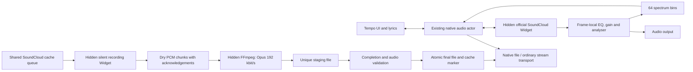

# SoundCloud browser playback and Opus cache

Date: 17 October 2026. Status: written design for user review; product integration has not started.

## Goal and agreed choices

Play SoundCloud tracks that expose only protected streams through the installed Windows WebView2 runtime, while keeping Tempo's queue, repeat, shuffle, lyrics and controls. Cache these tracks as ordinary local audio files when the browser exposes the authorized playback signal to Web Audio.

The user selected **Opus, 192 kbit/s VBR** for the resulting files. This makes a new lossy encoding of browser-rendered audio. The first complete copy takes approximately the track's duration, plus startup and finalization. Starting playback must not wait for this recording, including when “cache before playback” is enabled.

Reuse the existing SoundCloud login in About and the existing cache controls and progress indicators. Keep the browser transport hidden during playback. A sign-in window opens only through the existing explicit sign-in action. The built-in account remains unconfigured, as requested; do not package the diagnostic profile or its session.

## Evidence and its limits

Temporary probes on Windows with Tauri 2.11.5, Wry 0.55.1 and WebView2 155 established:

- Authorized official Widget playback of two protected example tracks used Widevine and encrypted AAC. Play, pause, seek, track replacement and playback while the native host was hidden worked.
- A hook installed in the media-owning widget frame could extend SoundCloud's existing Web Audio graph. Analyser output was nonzero; a +9 dB low shelf measured approximately +8.89 dB in the low band. Measured playback rates matched 0.5, 1 and 1.5. Both values of `preservesPitch` were accepted; perceptual time-stretch quality was not evaluated.
- One complete track, approximately 139.186 seconds, was recorded through `MediaStreamAudioDestinationNode` and PCM `MediaRecorder`. The authorized browser was closed before the resulting local files were independently decoded. FFmpeg was restricted to local `file,pipe` protocols for that decoding.
- The resulting Opus file was 3,147,219 bytes with a container duration of 139.196 seconds. The intermediate float PCM file was 139.189 seconds. These small differences include recording/container and encoder granularity; this does not establish sample-identical timing or the original encoded bitstream.
- The same runtime rejected Widevine `persistent-license`, including with the tested Chromium compatibility flag. The chosen design therefore stores newly recorded audio rather than restartable encrypted segments and a persistent EME license.

These are feasibility results, not completed Tempo features. The full-track probe required explicit recorder shutdown and duration trimming: SoundCloud rewound the HTML media element before its native `ended` event, while the official Widget `FINISH` event carried the finished track's position. Automatic production finalization, simultaneous foreground playback and background recording, memory pressure and release builds still require verification.

The reviewed yt-dlp/scdl, NewPipe, soundcloud-rpc, Kopuz and Auralis sources did not establish a working persistent-license SoundCloud offline implementation. The design uses the successfully probed browser recording path without adding Electron or a different CDM.

## Architecture

### Playback transport boundary

The native audio actor remains the single authority for the queue, current entry, repeat, shuffle, listening history, SMTC, persistence and recommendation continuation. Browser callbacks report observations; they cannot independently advance the queue or update listening history.

Replace the assumption that every `PreparedTrack` contains `PreparedAudio` with an explicit prepared transport: native audio or a validated SoundCloud browser descriptor. Do not represent a browser widget as a fake playable URL. A descriptor contains the numeric SoundCloud ID, canonical track URL, expected duration and playback generation; it contains no session credentials.

Source selection is:

1. Use an existing complete local file first, without network or session checks.
2. Retain the ordinary SoundCloud progressive/HLS path and its existing resolver/downloader fallbacks for supported clear streams.
3. Select the browser transport when metadata confirms protected-only formats, or a supported resolver returns an explicit protected-stream result. A generic HTTP failure is not sufficient classification. Preserve separate errors for missing tracks, authentication, region/entitlement restrictions and transient failures.

Known protected-only tracks should not repeatedly wait for downloader attempts that cannot handle them. Cache that classification with a bounded lifetime and invalidate it after a source/session change or explicit retry; do not permanently classify all failures as DRM.

All asynchronous commands and replies carry a transport generation and track ID. Ignore results belonging to an old selection. Browser creation, network work, recording and FFmpeg work stay off the actor's command-processing path; WebView lifecycle operations use Tauri's main-thread dispatch.

### Browser transport

Use a small local host page with one official SoundCloud iframe, controlled through Widget API. Install the frame-local enhancement script at document creation, before SoundCloud creates its media source. Reuse one foreground browser host across tracks and release it when no longer needed. Preserve the normal Wry autoplay configuration; do not ship a remote debugging port or depend on a synthetic user gesture.

Map play, pause, seek and volume to the Widget controls. Read actual media position and buffering state rather than advancing a second unsynchronized clock. On seek, suppress older clock replies until the seek result is observed. The actor emits the existing state/clock events for both transports.

Treat `FINISH` as a generation-checked end-of-track signal and process it once. The actor applies repeat-one by seeking/reloading the same entry, or selects the next entry through its existing repeat/shuffle/continuation rules. Ignore trailing PAUSE/PLAY/position-zero events from the completed generation.

Pause or stop the outgoing transport before making the incoming one audible. Crossfade remains available between native sources. Browser-involving transitions use a normal stop/start in the first version; do not silently run two audible transports to imitate crossfade. Completing a cache file does not force a mid-track switch: finish the current browser playback and use the local file on the next load.

The browser is a separate renderer from the main UI, but this design does not promise independence from every WebView2/browser or Tauri host-process failure. If the main UI reloads, reconstruct its view from the actor snapshot without restarting the current track.

### Authentication, capabilities and bridge

Foreground playback, background recording and the existing SoundCloud login must use the same persistent production WebView profile. The isolated research profile is not migrated into the product. An OAuth token usable by a REST resolver is not proof that an embedded browser has a signed-in session; rely on actual Widget access/capability results.

The local host may call only the narrow playback/recording bridge. SoundCloud remote content receives no general Tauri IPC capability. Validate the host label, exact allowed origins, iframe source, generation, track ID, message type, payload size and numeric ranges at every boundary. An instance nonce routes messages but is not an authentication guarantee against scripts in the same remote frame. Neither frame-supplied paths nor executable commands are accepted: native code derives destinations from the validated numeric ID and configured cache root.

Use frame-local Web Audio work and bounded `postMessage` communication; the local parent must not attempt cross-origin DOM access. Accept only the explicit control, state, capability, spectrum and recording message schemas. Reject new windows and unexpected navigation. Session cookies, authorization headers, license messages and CDM key material are not part of these schemas, logs or cache manifests.

Check playback and audio-processing capabilities independently. If official playback works but graph enhancement fails after an upstream change, keep playback available and report unsupported controls accurately. If protected playback itself fails, return an actionable session/runtime/access error through the existing error UI. A DSP failure must not cause repeated reinitialization or duplicate audible output.

## Browser audio processing

Capture SoundCloud's existing `MediaElementAudioSourceNode` at its creation. Do not create a second source for the same element. Insert the Tempo processing chain once, preserve SoundCloud's original downstream output, and dispose the old graph on replacement. Apply settings to every newly created source, not just the first track.

- **Equalizer:** preserve the current native curve as the reference. Its ten bands are 32/64/125/250/500/1000/2000/4000/8000/16000 Hz, with low/high shelves at the ends. Share the native coefficient calculation/profile with the browser chain at its actual sample rate; do not reuse the different legacy frontend EQ curve. The saved ten gains retain their meaning.
- **Gain and clipping:** apply available track normalization gain and positive-EQ protection in the playback branch, with bounded validated values. Do not perform a new whole-track analysis before playback. Browser and native limiter algorithms may differ; verify headroom and disclose any audible mismatch rather than claiming bit-identical DSP.
- **Rate/pitch:** map the existing 0.5–2.0 rate and preserve-pitch boolean to the actual media element. Apply them after source replacement as well as on user changes. There is no new independent semitone control.
- **Spectrum:** sample the audible branch after processing; fold to the existing 64 finite bins in [0,1], with a maximum of 30 updates per second. Retain frontend smoothing and stale-frame behavior. Clear/decay correctly on pause and source replacement. Recording-only hosts never feed the foreground visualizer.

## Real-time cache

### Scheduling and isolation

Extend the shared SoundCloud cache entry point so likes, playlist import/copy, drag-and-drop, recommendations and explicit cache actions all reach the same per-track deduplication and completion logic. Metadata/artwork preparation and a queued job are not evidence of a complete audio cache.

Use one silent recording host and one active DRM recording job at a time. A job runs the track from zero, at rate 1 with pitch preservation enabled, independently of the user's playback position, volume and effects. Record a dry branch before Tempo effects and SoundCloud's user-volume controls. Silence the monitor branch without muting the recorded signal or suspending its AudioContext. Never record system loopback or microphone audio.

Foreground playback has priority. Configure Widgets to permit independent playback where supported, but verify simultaneous use in the production profile. If a second Widget pauses or interrupts the foreground track, stop the recording attempt and defer it while browser foreground playback is active. Do not enter a restart loop. The initial version may finish these deferred jobs when foreground playback is native or stopped; it must display them as pending rather than silently complete. This fallback is required because two independent hosts were not validated by the feasibility probe.

Cancel duplicate attempts by attaching callers to one shared job. A single caller's cancellation detaches that caller; a job is stopped when no requesters remain, on explicit global cancellation, or on an invalid recording. Playlist progress counts a track only after finalization; recording time is not counted as user listening history.

### Streaming and encoding

Use the verified `audio/webm;codecs=pcm` MediaRecorder path with approximately 500 ms chunks. Feed ordered PCM container chunks incrementally into the existing FFmpeg helper to encode **Ogg Opus, 192 kbit/s VBR**. Start FFmpeg hidden using the project's Windows process flags. Use the runtime's actual supported channel layout/sample rate and record the final values; do not silently substitute a different codec or bitrate. If PCM recording or the Opus encoder is unavailable, fail that cache attempt clearly and retain browser playback.

Bound the transport: split messages to at most 256 KiB of binary payload, permit at most eight unacknowledged messages and 2 MiB of queued binary payload, and acknowledge only after native code has accepted the bytes into its bounded writer. Include job ID, track ID, generation, monotonically increasing sequence and final-chunk marker. Reject duplicates, gaps and stale chunks. Base64/serialization overhead must also have a fixed cap. Do not retain the entire track in JavaScript, Rust memory or a JSON event.

Backpressure overflow fails the attempt and removes its partial output; it must not drop audio chunks or pause only the recorder while the song keeps advancing. Stop playback/recording and FFmpeg together on cancellation, bridge loss or write failure. Queued work cannot keep orphan WebViews or child processes alive.

### Timeline and completion

Use a unique staging name under the existing SoundCloud cache root, ending in `.opus.part`. Final files use the validated SoundCloud ID and `.opus`, already supported by cache lookup. A partial file is never returned by normal playback or startup cache discovery.

The recording state machine is:

`queued -> preparing -> recording -> finalizing -> ready`

Any nonterminal state may end in `cancelled` or `failed`; deferred work returns to `queued` with its partial attempt discarded. Capture starts at media position zero. Keep a monotonic capture timeline and media-position observations so startup latency, buffering and the Widget's final reset cannot be mistaken for song audio. Freeze recording coverage during source stalls. Pause/resume the recorder with source readiness; if measured coverage is discontinuous or synchronization is uncertain, fail and retry from zero rather than splice an unverified gap.

Finalize only when all of these hold:

1. The official Widget reports `FINISH` for the expected active track/generation, verified against `getCurrentSound` and the job descriptor. Do not wait only for `HTMLMediaElement.ended` and do not trust an unrelated position-zero event.
2. The expected full duration is positive and agrees with Widget duration. A short preview does not satisfy this check. Cache preparation rejects unknown/full-duration mismatches instead of promoting a preview.
3. Media-position coverage starts at zero, reaches the expected end and contains no seek, rate change, missing sequence or unexplained discontinuity. A source pause/stall may extend wall time but not the saved song timeline.
4. Stop the recorder, drain its final data/stop events and acknowledge all chunks before closing the FFmpeg input. Trim only measured capture lead-in/trailing recording overhead, never intentional silence within the song. The production start/end alignment must be measured; the probe's explicit final trim is not an automatic solution.
5. FFmpeg exits successfully. Validate a nonempty Ogg/Opus audio stream, codec/rate, decodability and decoded duration against the expected song duration. Initial acceptance allows at most 100 ms at either edge and 250 ms total duration difference, including codec padding. These bounds are acceptance targets, not results already established for production. Do not extend tolerances to accept an interrupted recording.
6. Atomically promote the staging file, finalize normal track/album/artist metadata and artwork through the existing cache path, then set the database cache marker and emit `done`. Reuse a previously valid final file rather than overwrite it with an incomplete attempt.

Cache status is recoverable across the rename/database boundary: a verified final file left by a database failure can be finalized on the next attempt, while `.part` files remain excluded. Startup removes stale staging files belonging to abandoned jobs. Completed files participate in existing cache-size limits and eviction.

### Progress, resource limits and recovery

Extend the per-track cache event with optional phase, progress basis, recorded milliseconds and expected milliseconds. Keep existing byte fields for ordinary downloads; do not pretend media time is downloaded bytes. The UI computes DRM recording progress from verified media coverage, capped below 100% until file/metadata finalization. Reuse the current ring/percentage/fade; queued/preparing/finalizing states remain distinguishable without adding a separate settings panel.

Use bounded startup and stall timeouts: 30 seconds for Widget readiness, 30 seconds without media/ack progress, and a total attempt budget of `max(120 seconds, 2 * expected duration + 60 seconds)`. Finalization has a separate 30-second timeout. Report the failed phase; automatic retry is limited to one transient retry with backoff. Authentication/access errors wait for an explicit retry or session change. A playback transport crash may attempt one guarded reload at its last confirmed position; cache recording always restarts from zero.

Release the recording host when its queue empties. Browser recording must not start a second native decoder or repeatedly measure loudness. Serialize expensive work and keep the actor responsive under memory pressure. Cancellation clears pending chunks, closes input pipes, terminates the owned encoder if needed and removes staging files without touching another job's or a valid final file.

## Code boundaries

| Area | Responsibility |
| --- | --- |
| `src-tauri/src/soundcloud.rs` | Typed clear/protected/unavailable resolution, preview exclusion and track identity. |
| `src-tauri/src/soundcloud_session.rs` | Existing production profile/login integration and sanitized session status. |
| New focused `soundcloud_browser` Rust/JS modules and local host page | WebView lifecycle, Widget control, frame-local DSP/recording, validated bounded bridge and capabilities. Keep playback transport and recording jobs separate. |
| `src-tauri/src/native_audio/{models,resolver,actor}.rs` | Prepared transport variant, actor commands/events, generation guards, shared queue/clock/end behavior and recovery. |
| `src-tauri/src/native_audio/output/dsp.rs` and focused shared EQ definitions | Native-reference EQ coefficient/profile reuse; native output keeps current behavior. |
| `src-tauri/src/soundcloud_store.rs` and `soundcloud_store/cache_download.rs` | Shared job/deduplication, recording dispatch, encoder/staging validation, metadata finalization and progress. Extract focused helpers if required instead of growing the store indefinitely. |
| `src/player/nativeController.ts`, `src/audio/spectrum.ts` and shared cache progress UI/store | Consume existing player events plus explicit capabilities and additive progress fields. No second frontend-owned queue or independent DRM clock. |

No new account-provider service, shared account credentials, browser-session selector, Electron runtime or generalized audio-engine rewrite is included. Windows is the verified target for this browser route; other platforms retain existing playback until separately checked.

## Verification before shipping

Use the user's authorized runtime experiments and normal compile/type checks. Do not introduce new test suites without a separate request. Preserve the existing tests and interfaces while refactoring.

- Verify production-host playback and enhancement on both protected examples, logged-in and expired/missing-session cases, plus ordinary progressive/HLS and offline cached playback.
- Exercise repeat-one from SoundCloud search, repeat-all, existing shuffle, seek, next/previous, queue replacement, speed/preserve-pitch/EQ, lyrics timing, SMTC and UI reload. Ensure old callbacks cannot finish or change a new entry.
- Record one full track automatically using `FINISH`; verify start/end alignment, internal silence, no trailing recording tail, correct ID/metadata/artwork and independent local decoding after browser shutdown. Then load the final file through Tempo's native player with network access to SoundCloud unavailable.
- Verify that foreground user seeks/rate/volume changes cannot alter an independent cache recording, and that a recording host cannot pause audible playback. Exercise the deferred scheduling fallback if the platform does not allow both.
- Check likes, playlist import/copy, drag-and-drop and recommendations against the same job; verify one encoder, truthful progress, cancellation, startup cleanup, disk-full/error handling and cache limits.
- Exercise missing chunks, stale `FINISH`, renderer/bridge failure, stalled source, encoder failure and app exit. Every incomplete attempt must remain uncached and leave no active recording/encoder.
- Observe memory/IPC bounds and actor responsiveness during a full recording and several queued tracks. Verify hidden playback without synthetic user activation and inspect a release build with no debugging port, console flash or shipped diagnostic profile.

Success means the supported protected track starts without a full-recording wait, the existing player controls stay coherent, and a cache marker refers to a complete independently playable Opus file. Unsupported runtime/policy cases must fail visibly and finitely without claiming universal DRM compatibility.

## Primary references

- [SoundCloud Widget API](https://developers.soundcloud.com/docs/api/html5-widget): official playback controls, events and independent-widget parameter.
- [Web Audio specification](https://www.w3.org/TR/webaudio-1.1/): graph processing and media stream destination.
- [MediaStream Recording specification](https://www.w3.org/TR/mediastream-recording/): recorder lifecycle and chunk delivery. Individual chunks are not assumed to be independently playable files.
- [Encrypted Media Extensions](https://www.w3.org/TR/encrypted-media/): temporary and persistent sessions and runtime-specific audio exposure.
- [yt-dlp SoundCloud extractor](https://github.com/yt-dlp/yt-dlp/blob/master/yt_dlp/extractor/soundcloud.py) and [DRM issue](https://github.com/yt-dlp/yt-dlp/issues/17335): existing encrypted-format limit.
- [soundcloud-rpc 0.2.0](https://github.com/richardhbtz/soundcloud-rpc/releases/tag/v0.2.0): a browser/CDM playback approach in another open-source client, not proof of its offline caching.

Sanitized local research reports and measurements are retained in the ignored `.task-plans/research/` directory. Captured audio and authenticated browser profiles are local experiment artifacts and are not part of the repository or release.
