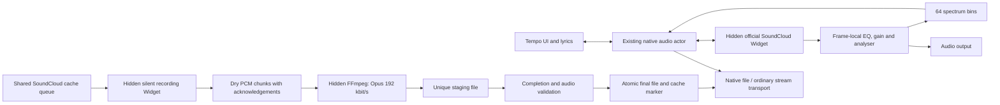

# SoundCloud browser playback and Opus cache

Date: 17 October 2026. Status: implementation authorized after playback, recording, block-count experiments and the user's settings requirements.

## Goal and agreed choices

Play SoundCloud tracks that expose only protected streams through the installed Windows WebView2 runtime, while keeping Tempo's queue, repeat, shuffle, lyrics and controls. Cache these tracks as ordinary local audio files when the browser exposes the authorized playback signal to Web Audio.

The user selected **Opus, 192 kbit/s VBR** for the resulting files. This makes a new lossy encoding of browser-rendered audio. Split a first copy into concurrent normal-speed recording blocks with overlapping boundaries, then align and encode once. Starting playback must not wait for recording, including when “cache before playback” is enabled.

Reuse the existing SoundCloud login in About and the existing cache controls and progress indicators. Keep the browser transport hidden during playback. A sign-in window opens only through the existing explicit sign-in action. The built-in account remains unconfigured, as requested; do not package the diagnostic profile or its session.

## Evidence and its limits

Temporary probes on Windows with Tauri 2.11.5, Wry 0.55.1 and WebView2 155 established:

- Authorized official Widget playback of two protected example tracks used Widevine and encrypted AAC. Play, pause, seek, track replacement and playback while the native host was hidden worked.
- A hook installed in the media-owning widget frame could extend SoundCloud's existing Web Audio graph. Analyser output was nonzero; a +9 dB low shelf measured approximately +8.89 dB in the low band. Measured playback rates matched 0.5, 1 and 1.5. Both values of `preservesPitch` were accepted; perceptual time-stretch quality was not evaluated.
- One complete track, approximately 139.186 seconds, was recorded through `MediaStreamAudioDestinationNode` and PCM `MediaRecorder`. The authorized browser was closed before the resulting local files were independently decoded. FFmpeg was restricted to local `file,pipe` protocols for that decoding.
- The resulting Opus file was 3,147,219 bytes with a container duration of 139.196 seconds. The intermediate float PCM file was 139.189 seconds. These small differences include recording/container and encoder granularity; this does not establish sample-identical timing or the original encoded bitstream.
- The same runtime rejected Widevine `persistent-license`, including with the tested Chromium compatibility flag. The chosen design therefore stores newly recorded audio rather than restartable encrypted segments and a persistent EME license.

These are feasibility results, not completed Tempo features. The full-track probe required explicit recorder shutdown and duration trimming: SoundCloud rewound the HTML media element before its native `ended` event, while the official Widget `FINISH` event carried the finished track's position. Automatic production finalization, simultaneous foreground playback and background recording, memory pressure and release builds still require verification.

The reviewed yt-dlp/scdl, NewPipe, soundcloud-rpc, Kopuz and Auralis sources did not establish a working persistent-license SoundCloud offline implementation. The design uses the successfully probed browser recording path without adding Electron or a different CDM.

## Architecture

### Playback transport boundary

The native audio actor remains the single authority for the queue, current entry, repeat, shuffle, listening history, SMTC, persistence and recommendation continuation. Browser callbacks report observations; they cannot independently advance the queue or update listening history.

Replace the assumption that every `PreparedTrack` contains `PreparedAudio` with an explicit prepared transport: native audio or a validated SoundCloud browser descriptor. Do not represent a browser widget as a fake playable URL. A descriptor contains the numeric SoundCloud ID, canonical track URL, expected duration and playback generation; it contains no session credentials.

Source selection is:

1. Use an existing complete local file first, without network or session checks.
2. Retain the ordinary SoundCloud progressive/HLS path and its existing resolver/downloader fallbacks for supported clear streams.
3. Select the browser transport when metadata confirms protected-only formats, or a supported resolver returns an explicit protected-stream result. A generic HTTP failure is not sufficient classification. Preserve separate errors for missing tracks, authentication, region/entitlement restrictions and transient failures.

Known protected-only tracks should not repeatedly wait for downloader attempts that cannot handle them. Cache that classification with a bounded lifetime and invalidate it after a source/session change or explicit retry; do not permanently classify all failures as DRM.

All asynchronous commands and replies carry a transport generation and track ID. Ignore results belonging to an old selection. Browser creation, network work, recording and FFmpeg work stay off the actor's command-processing path; WebView lifecycle operations use Tauri's main-thread dispatch.

### Browser transport

Use a small local host page with one official SoundCloud iframe, controlled through Widget API. Install the frame-local enhancement script at document creation, before SoundCloud creates its media source. Use one hidden foreground host for the active playback generation. Each generation has a unique native window label; delayed cleanup cannot close a newer host. Preserve the normal Wry autoplay configuration; do not ship a remote debugging port or depend on a synthetic user gesture.

Map play, pause, seek and volume to the Widget controls. Read actual media position and buffering state rather than advancing a second unsynchronized clock. On seek, suppress older clock replies until the seek result is observed. The actor emits the existing state/clock events for both transports.

Treat `FINISH` as a generation-checked end-of-track signal and process it once. The actor applies repeat-one by seeking/reloading the same entry, or selects the next entry through its existing repeat/shuffle/continuation rules. Ignore trailing PAUSE/PLAY/position-zero events from the completed generation.

Pause or stop the outgoing transport before making the incoming one audible. Crossfade remains available between native sources. Browser-involving transitions use a normal stop/start in the first version; do not silently run two audible transports to imitate crossfade. Completing a cache file does not force a mid-track switch: finish the current browser playback and use the local file on the next load.

The browser is a separate renderer from the main UI, but this design does not promise independence from every WebView2/browser or Tauri host-process failure. If the main UI reloads, reconstruct its view from the actor snapshot without restarting the current track.

### Authentication, capabilities and bridge

Foreground playback, background recording and the existing SoundCloud login must use the same persistent production WebView profile. The isolated research profile is not migrated into the product. An OAuth token usable by a REST resolver is not proof that an embedded browser has a signed-in session; rely on actual Widget access/capability results.

The local host may call only the narrow playback/recording bridge. SoundCloud remote content receives no general Tauri IPC capability. Validate the host label, exact allowed origins, iframe source, generation, track ID, message type, payload size and numeric ranges at every boundary. An instance nonce routes messages but is not an authentication guarantee against scripts in the same remote frame. Neither frame-supplied paths nor executable commands are accepted: native code derives destinations from the validated numeric ID and configured cache root.

Use frame-local Web Audio work and bounded `postMessage` communication; the local parent must not attempt cross-origin DOM access. Accept only the explicit control, state, capability, spectrum and recording message schemas. Reject new windows and unexpected navigation. Session cookies, authorization headers, license messages and CDM key material are not part of these schemas, logs or cache manifests.

Check playback and audio-processing capabilities independently. If official playback works but graph enhancement fails after an upstream change, keep playback available and report unsupported controls accurately. If protected playback itself fails, return an actionable session/runtime/access error through the existing error UI. A DSP failure must not cause repeated reinitialization or duplicate audible output.

## Browser audio processing

Capture SoundCloud's existing `MediaElementAudioSourceNode` at its creation. Do not create a second source for the same element. Insert the Tempo processing chain once, preserve SoundCloud's original downstream output, and dispose the old graph on replacement. Apply settings to every newly created source, not just the first track.

- **Equalizer:** preserve the current native curve as the reference. Its ten bands are 32/64/125/250/500/1000/2000/4000/8000/16000 Hz, with low/high shelves at the ends. Match the native band frequencies, filter types and Q values at the browser context sample rate; do not reuse the different legacy frontend EQ curve. The saved ten gains retain their meaning.
- **Gain and clipping:** apply available track normalization gain and positive-EQ protection in the playback branch, with bounded validated values. Do not perform a new whole-track analysis before playback. Browser and native limiter algorithms may differ; verify headroom and disclose any audible mismatch rather than claiming bit-identical DSP.
- **Rate/pitch:** map the existing 0.5–2.0 rate and preserve-pitch boolean to the actual media element. Apply them after source replacement as well as on user changes. There is no new independent semitone control.
- **Spectrum:** sample the audible branch after processing; fold to the existing 64 finite bins in [0,1], with a maximum of 30 updates per second. Retain frontend smoothing and stale-frame behavior. Clear/decay correctly on pause and source replacement. Recording-only hosts never feed the foreground visualizer.

## Segmented cache: updated requirements

The following requirements extend the original single-recorder design. The playback transport and completion guarantees still apply.

- One protected-track job uses a hidden host with independent official Widgets, `single_active=false`, at rate 1. Each adjacent pair shares 600 ms of audio. A start gate prevents upstream autoplay after seeking from advancing a prepared element before its recorder is armed. Verify actual start/end coverage for every block.
- Stage bounded PCM WebM chunks per block on disk. Align only neighboring overlap windows using correlation, apply an 8 ms blend within shared audio, and encode the assembled full timeline to one Opus file. No reference recording is needed for assembly. Uncertain coverage/alignment fails the attempt rather than silently leaving a hole.
- The last block ends on the matching official Widget FINISH; earlier blocks stop at their verified media boundary. Sum unique covered time, excluding overlaps, for progress; keep it below 100% until validation, promotion and metadata completion.
- At the bottom of General, show “Automatically choose blocks”, enabled by default. Automatic selection is 1–8 based on current total CPU use and available memory, sampled away from the audio actor. When disabled, show an integer slider 1–12. Persist both the mode and manual value. Choose before starting a job; do not discard good audio if system load changes. Stop cleanly if memory falls below a hard safety reserve.
- Show these controls only with a validated working personal or built-in session. A configured token or transient network failure alone does not establish browser capability. Settings and About share refreshed sanitized session state after login/logout/expiry.
- Personal SoundCloud login exposes Sign out. Close personal browser playback/recorders and login views, remove only SoundCloud authentication state and invalidate validation results. Never remove library, settings or completed cache files. Built-in credentials have no sign-out action.
- Without a usable session, About shows a yellow outlined warning with emphasized useful text. A transient unchecked session is described as unverified, not expired.

The initial 139.186 s probe produced a joined three-block Opus recording; the user reported no audible joins. Later integration trials completed recording, joining, encoding and validation in 60.193 s with three blocks, 32.071 s with eight and 26.933 s with twelve. Each output decoded locally to 139.186479 s. Foreground playback continued during capture; the successful eight-block run peaked at about 709 MiB private resident memory including foreground playback. Comparison at seven reference positions found no accumulating drift, but the integrated outputs have not been auditioned by the user. These single-track Windows measurements do not establish a universal SoundCloud concurrency limit or timing guarantee.

## Cache scheduling and completion

All existing cache entry points continue through the shared per-track lock: playback, likes, recommendations, drag-and-drop and playlist imports. A completed local file is checked first and stays playable without a network/session check. Protected classification requires explicit encrypted variants and a full duration; an arbitrary HTTP error does not identify a protected track. Ordinary clear streams retain their downloader fallback.

One protected recording job runs at a time. Its host uses the same production browser profile as login and foreground playback, separate from the main UI renderer. Each official Widget records a planned normal-speed interval with a 300 ms margin on either side. Preparation holds playback during seeking; all recorders are armed before release. The last interval uses the matching Widget FINISH, while earlier intervals stop at their media boundary. User volume, rate and EQ do not alter the recording signal. Recording does not count as listening history and does not force an audible switch to the completed file.

The audible player's startup takes priority over creating recording Widgets. Reserve that priority when a protected playback is resolved, release it after the first advancing non-buffering clock plus a 500 ms settling interval, and expire abandoned reservations after 30 seconds. Waiting recording jobs remain cancellable; active recordings retain their completed work. Fetch the first Widget iframe and control script concurrently and avoid redundant pause/seek-to-zero commands on a new paused Widget. Metadata readiness alone does not end the player's initial preparation state: wait for the actual media clock to advance.

Exclude transient playback/recording/fallback window labels from the window-state plugin's restoration and tracking. Its default state for an unseen label can otherwise show and focus a helper despite the builder's hidden flag. Regular application-window restoration remains enabled.

Frame-local MediaRecorder produces PCM WebM data. Split its data into at most 64 KiB bridge chunks. Each frame retains at most 1 MiB awaiting acknowledgement, for at most 12 MiB with manual maximum concurrency. One native pull is capped at 2 MiB raw and 3 MiB serialized data; the host apportions that pull across frames in sequence order. Acknowledgement is compact and occurs only after native writes/flushes. Overflow, sequence gaps or invalid lengths fail the attempt rather than drop audio. This bounded queue replaces the initial design's smaller aggregate frame-retention limit, which was insufficient during real WebView2 scheduling delays.

Write PCM pieces into a uniquely owned private staging directory on disk. Local FFmpeg decodes each piece to 48 kHz stereo float PCM. Align only neighboring overlap windows, blend an 8 ms seam within shared audio, and encode one Opus 192 kbit/s VBR file. Processing reads bounded windows and streams file ranges rather than retaining a whole song in memory. FFmpeg uses hidden child processes and local file protocols for this stage.

Require valid source identity/full duration, measured start/end coverage, at least one nonzero audio observation, complete chunk sequences and a full decode of the assembled Opus. The first marker must cover zero within 10 ms; other marker errors cannot exceed 250 ms, and the assembled/decoded duration cannot differ by more than 250 ms. Do not promote an interrupted recording or a preview. Uncertain overlap alignment fails visibly and can be retried through the existing cache action.

Only after successful validation does the store atomically promote the unique `.opus.part`, finalize the existing library metadata/artwork path, set the cache marker and emit done. Partial files remain excluded from playback/cache lookup. Existing complete files are reused. Cleanup removes only this job's temporary files; startup also removes abandoned recording/join directories with reserved prefixes.

Automatic selection samples current total CPU load over 300 ms away from the audio actor, reserves foreground CPU capacity, and budgets available memory after a 1536 MiB reserve, 350 MiB host allowance and 128 MiB per block. It selects 1–8; manual preferences clamp to 1–12. If counters are unavailable, use one block. Before recording, check disk space for staged PCM/decoding/join/validation. Stop cleanly below 768 MiB available physical memory; this hard guard also applies to manual mode.

The per-track event carries a recording coverage fraction and phase alongside the unchanged download byte fields. Coverage is the union of media intervals, excluding overlap; recording occupies 0–90%, finalization 90–99%, and normal store completion supplies 100%. Reuse the existing ring, percentage and fade.

Startup/frame requests have finite 30-second readiness budgets. A source stalled for 30 seconds or an attempt beyond its duration budget fails. Cancellation/logout/app shutdown invalidates active and queued capture work, closes owned hosts, cancels local processing and removes incomplete output. Batch cancellation retains the existing policy of finishing its current track before stopping subsequent tracks. Authentication/access failures require sign-in or explicit retry. No general remote Tauri IPC, credentials, license messages or CDM keys are part of the bridge.

## Session controls

`browserAvailable` requires a validated OAuth cookie actually present in the shared WebView profile. A built-in token that only authorizes API requests does not establish browser login, hide the sign-in action or reveal capture controls. If a browser cookie matches the configured built-in token, it is identified as built-in and has no sign-out action. Otherwise the personal session has a Sign out action, including when expired.

Logout closes login/playback/recording/resolver views before removing SoundCloud-domain cookies and clearing the validation cache. Completed local audio and Tempo's library/settings are preserved. About uses a yellow outlined, emphasized warning for absent/unverified login; status refreshes after login/logout, on focus and periodically while visible. General shows the capture controls only when `browserAvailable` is true.

## Code boundaries

| Area | Responsibility |
| --- | --- |
| `src-tauri/src/soundcloud.rs` | Typed clear/protected/unavailable resolution, preview exclusion and track identity. |
| `src-tauri/src/soundcloud_session.rs` | Existing production profile/login integration and sanitized session status. |
| New focused `soundcloud_browser` Rust/JS modules and local host page | WebView lifecycle, Widget control, frame-local DSP/recording, validated bounded bridge and capabilities. Keep playback transport and recording jobs separate. |
| `src-tauri/src/native_audio/{models,resolver,actor}.rs` | Prepared transport variant, actor commands/events, generation guards, shared queue/clock/end behavior and recovery. |
| `src-tauri/src/native_audio/output/dsp.rs` and the browser frame processing graph | Native DSP remains the reference; the browser graph matches its band frequencies, filter types and Q values without changing native output. |
| `src-tauri/src/soundcloud_store.rs` and `soundcloud_store/cache_download.rs` | Shared job/deduplication, recording dispatch, encoder/staging validation, metadata finalization and progress. Extract focused helpers if required instead of growing the store indefinitely. |
| `src/player/nativeController.ts`, `src/audio/spectrum.ts` and shared cache progress UI/store | Consume existing player events plus explicit capabilities and additive progress fields. No second frontend-owned queue or independent DRM clock. |

No new account-provider service, shared account credentials, browser-session selector, Electron runtime or generalized audio-engine rewrite is included. Windows is the verified target for this browser route; other platforms retain existing playback until separately checked.

## Verification before shipping

Use the user's authorized runtime experiments and normal compile/type checks. Do not introduce new test suites without a separate request. Preserve the existing tests and interfaces while refactoring.

- Verify production-host playback and enhancement on both protected examples, logged-in and expired/missing-session cases, plus ordinary progressive/HLS and offline cached playback.
- Exercise repeat-one from SoundCloud search, repeat-all, existing shuffle, seek, next/previous, queue replacement, speed/preserve-pitch/EQ, lyrics timing, SMTC and UI reload. Ensure old callbacks cannot finish or change a new entry.
- Record one full track automatically using `FINISH`; verify start/end alignment, internal silence, no trailing recording tail, correct ID/metadata/artwork and independent local decoding after browser shutdown. Then load the final file through Tempo's native player with network access to SoundCloud unavailable.
- Verify that foreground user seeks/rate/volume changes cannot alter an independent cache recording, and that a recording host cannot pause audible playback. Exercise the deferred scheduling fallback if the platform does not allow both.
- Check likes, playlist import/copy, drag-and-drop and recommendations against the same job; verify one encoder, truthful progress, cancellation, startup cleanup, disk-full/error handling and cache limits.
- Exercise missing chunks, stale `FINISH`, renderer/bridge failure, stalled source, encoder failure and app exit. Every incomplete attempt must remain uncached and leave no active recording/encoder.
- Observe memory/IPC bounds and actor responsiveness during a full recording and several queued tracks. Verify hidden playback without synthetic user activation and inspect a release build with no debugging port, console flash or shipped diagnostic profile.

Success means the supported protected track starts without a full-recording wait, the existing player controls stay coherent, and a cache marker refers to a complete independently playable Opus file. Unsupported runtime/policy cases must fail visibly and finitely without claiming universal DRM compatibility.

## Primary references

- [SoundCloud Widget API](https://developers.soundcloud.com/docs/api/html5-widget): official playback controls, events and independent-widget parameter.
- [Web Audio specification](https://www.w3.org/TR/webaudio-1.1/): graph processing and media stream destination.
- [MediaStream Recording specification](https://www.w3.org/TR/mediastream-recording/): recorder lifecycle and chunk delivery. Individual chunks are not assumed to be independently playable files.
- [Encrypted Media Extensions](https://www.w3.org/TR/encrypted-media/): temporary and persistent sessions and runtime-specific audio exposure.
- [yt-dlp SoundCloud extractor](https://github.com/yt-dlp/yt-dlp/blob/master/yt_dlp/extractor/soundcloud.py) and [DRM issue](https://github.com/yt-dlp/yt-dlp/issues/17335): existing encrypted-format limit.
- [soundcloud-rpc 0.2.0](https://github.com/richardhbtz/soundcloud-rpc/releases/tag/v0.2.0): a browser/CDM playback approach in another open-source client, not proof of its offline caching.

Sanitized local research reports and measurements are retained in the ignored `.task-plans/research/` directory. Captured audio and authenticated browser profiles are local experiment artifacts and are not part of the repository or release.
